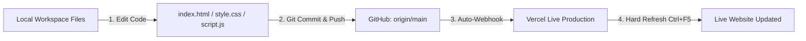

# alamincore Website Update & Vercel Deployment Workflow

This reference guide documents the end-to-end process for updating website content and automatically deploying changes to the live Vercel production site.

---

## Architecture Overview



---

## 1. File Structure & Responsibilities

| File | Purpose | Where to Update |
| :--- | :--- | :--- |
| `index.html` | HTML Structure & Content | Bio text, stats, links, contact details, social profiles |
| `style.css` | Styling & Responsive Design | Colors, fonts, hover states, spacing, responsive layout |
| `script.js` | Interactive Logic | Counters, mobile navigation, modals, contact form submit |
| `vercel.json` | Vercel Server & Routing Config | URL rewrites and server routing rules |

---

## 2. Common Update Locations

### A. Experience & Statistics
- **Hero Counter**: `index.html` (`.hero-stat`)
  ```html
  <div class="hero-stat">
    <h3><span class="counter" data-target="3">0</span>+</h3>
    <p>Years Experience</p>
  </div>
  ```
- **About Modal Badge**: `index.html` (`.experience-badge`)
  ```html
  <div class="experience-badge">
    <h4>3+</h4>
    <p>Years of<br/>Excellence</p>
  </div>
  ```
- **About Founder Bio**: `index.html` (`.about-content p.section-subtitle`)

### B. Contact Information & Social Profiles
- **Phone Number**: `index.html` (`.contact-info-list`)
  ```html
  <p><a href="tel:+8801925495635">+880 1925-495635</a></p>
  ```
- **Email Address**: `index.html` (`.contact-info-list`)
  ```html
  <p><a href="mailto:alamin17ma@gmail.com">alamin17ma@gmail.com</a></p>
  ```
- **Social Links**: `index.html` (`.social-links`)
  - Facebook: `id="social-facebook"` (`href="https://www.facebook.com/al.amin.198396"`)
  - LinkedIn: `id="social-linkedin"` (`href="https://www.linkedin.com/in/al-amin-b618b734b/"`)

---

## 3. Step-by-Step Deployment Routine

Whenever changes are made, run the following commands in the terminal (or ask the AI assistant to do it for you):

### Step 1: Check Modified Files
```bash
git status
```

### Step 2: Stage & Commit Changes
```bash
git add .
git commit -m "Describe your update here (e.g. Update services and contact details)"
```

### Step 3: Push to GitHub (Triggers Live Vercel Deployment)
```bash
git push origin main
```

### Step 4: Verify Deployment on Vercel
1. Vercel automatically starts building upon git push.
2. Visit the [Vercel Dashboard](https://vercel.com/dashboard) to confirm the deployment status is **Ready**.
3. Open your live website.
4. Press **`Ctrl + F5`** (Windows) to hard-refresh and bypass browser cache.

---

> Local edits alone will **never** update the live site until they are committed and pushed to GitHub.
